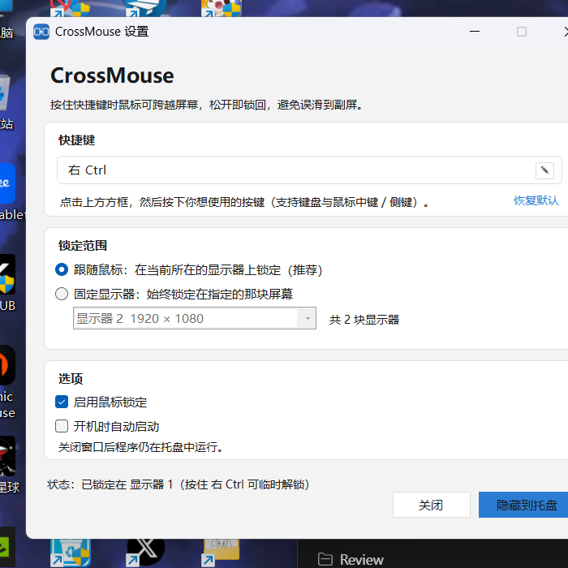

# CrossMouse

**按住一个快捷键，鼠标才能跨越屏幕；松开自动锁回。**

多显示器用户常遇到一个问题：光标太容易滑出主屏，跑到旁边的副屏上去。CrossMouse 让鼠标指针默认被锁在当前显示器内，只有按住你指定的按键时才临时解锁，允许跨屏。

<p align="center"></p>

## 功能

- **按住解锁，松开锁回** — 默认快捷键是右 `Ctrl`，可自行改成任意键盘按键或鼠标中键 / 侧键
- **跟随鼠标锁定** — 光标在哪块屏幕上，就锁在哪块；也可以指定固定锁定某块显示器
- **托盘常驻** — 关闭窗口后继续在后台工作，托盘图标会显示当前是「锁定」还是「已解锁」
- **开机自启** — 一键写入 `HKCU\...\Run`，不需要管理员权限
- **自动适应** — 插拔显示器、修改分辨率、切换用户时会自动重新计算锁定范围
- **崩溃保护** — 有一个看门狗进程守着；即使主程序被强杀，也会立刻解除锁定，不会把鼠标困在单屏

## 使用

1. 下载 [Releases](https://github.com/Mingmyal/CrossMouse/releases) 里的 `CrossMouse.zip`，解压到任意目录
2. 双击 `CrossMouse.exe`，在设置窗口里点击快捷键方框，按下想用的按键
3. 关闭窗口，程序会留在右下角托盘

之后：

| 操作 | 效果 |
| --- | --- |
| 正常移动鼠标 | 光标被限制在当前屏幕内 |
| **按住** 快捷键 | 光标可以自由跨越所有屏幕 |
| **松开** 快捷键 | 光标立刻锁回当前所在的屏幕 |
| 托盘图标双击 | 打开设置 |
| 托盘右键 | 暂停 / 开机自启 / 设置 / 退出 |

## 系统要求

- Windows 10 / 11（x64 或 ARM64）
- 不需要 .NET 运行时安装，也不需要管理员权限
- 程序本身只有 70 KB 左右

## 从源码构建

不需要安装 Visual Studio，用 Windows 自带的 C# 编译器就行：

```powershell
git clone https://github.com/Mingmyal/CrossMouse
cd CrossMouse
powershell -ExecutionPolicy Bypass -File .\build.ps1
```

产物在 `dist\Release\CrossMouse.exe`，同时会生成可分发的 `CrossMouse-win.zip`。

如果你装了 MSBuild，也可以直接用项目文件：

```powershell
powershell -File .\build.ps1 -MSBuild
```

## 工作原理

程序调用 Win32 的 `ClipCursor()` 把光标限制在当前显示器的矩形范围内。按住快捷键时，它调用 `ClipCursor(NULL)` 解除限制；松开时重新锁定。

为了让快捷键反应够快，程序装了一个低层键盘/鼠标钩子（`WH_KEYBOARD_LL` / `WH_MOUSE_LL`），按键一按下就立刻响应，而不是靠轮询。如果钩子被安全软件拦下装不上，会自动退回高频轮询，功能不受影响。

## 项目结构

```
src/
  Program.cs        入口、单实例、命令行参数
  TrayApp.cs        托盘图标、菜单、生命周期
  Guard.cs          核心：锁定 / 解锁 / 跟随显示器
  Hooks.cs          低层键盘与鼠标钩子
  SettingsForm.cs   设置界面
  Watchdog.cs       崩溃后自动解除锁定的看门狗
  Model.cs          显示器信息、设置持久化、按键名称
  Theme.cs          界面主题与自绘控件
  IconArt.cs        程序图标（代码绘制）
  Native.cs         Win32 互操作声明
build.ps1           零依赖构建脚本
```

## 许可

[MIT](LICENSE)
